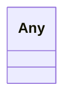

---
search:
  boost: 10.0
---

# Class: Any 


_A wildcard type that accepts any value. Used where the model deliberately avoids coupling to a specific range, such as embedded LinkML definition objects._


<div data-search-exclude markdown="1">


URI: [linkml:Any](https://w3id.org/linkml/Any)





<!-- no inheritance hierarchy -->

## Class Properties

| Property | Value |
| --- | --- |
| Class URI | [linkml:Any](https://w3id.org/linkml/Any) |


## Slots

| Name | Cardinality and Range | Description | Inheritance |
| ---  | --- | --- | --- |


## Usages

| used by | used in | type | used |
| ---  | --- | --- | --- |
| [TransformationSpecification](../classes/TransformationSpecification.md) | [source_schema_patches](../slots/source_schema_patches.md) | range | [Any](../classes/Any.md) |
| [ElementDerivation](../classes/ElementDerivation.md) | [overrides](../slots/overrides.md) | range | [Any](../classes/Any.md) |
| [ClassDerivation](../classes/ClassDerivation.md) | [target_definition](../slots/target_definition.md) | range | [Any](../classes/Any.md) |
| [ClassDerivation](../classes/ClassDerivation.md) | [overrides](../slots/overrides.md) | range | [Any](../classes/Any.md) |
| [ObjectDerivation](../classes/ObjectDerivation.md) | [overrides](../slots/overrides.md) | range | [Any](../classes/Any.md) |
| [SlotDerivation](../classes/SlotDerivation.md) | [value](../slots/value.md) | range | [Any](../classes/Any.md) |
| [SlotDerivation](../classes/SlotDerivation.md) | [missing_values](../slots/missing_values.md) | range | [Any](../classes/Any.md) |
| [SlotDerivation](../classes/SlotDerivation.md) | [target_definition](../slots/target_definition.md) | range | [Any](../classes/Any.md) |
| [SlotDerivation](../classes/SlotDerivation.md) | [overrides](../slots/overrides.md) | range | [Any](../classes/Any.md) |
| [EnumDerivation](../classes/EnumDerivation.md) | [overrides](../slots/overrides.md) | range | [Any](../classes/Any.md) |
| [PermissibleValueDerivation](../classes/PermissibleValueDerivation.md) | [overrides](../slots/overrides.md) | range | [Any](../classes/Any.md) |
| [PrefixDerivation](../classes/PrefixDerivation.md) | [overrides](../slots/overrides.md) | range | [Any](../classes/Any.md) |
| [KeyVal](../classes/KeyVal.md) | [value](../slots/value.md) | range | [Any](../classes/Any.md) |
| [CopyDirective](../classes/CopyDirective.md) | [exclude](../slots/exclude.md) | range | [Any](../classes/Any.md) |
| [CopyDirective](../classes/CopyDirective.md) | [include](../slots/include.md) | range | [Any](../classes/Any.md) |
| [CopyDirective](../classes/CopyDirective.md) | [add](../slots/add.md) | range | [Any](../classes/Any.md) |


## Identifier and Mapping Information


### Schema Source


* from schema: https://w3id.org/linkml/transformer


## Mappings

| Mapping Type | Mapped Value |
| ---  | ---  |
| self | linkml:Any |
| native | linkmlmap:Any |


## LinkML Source

<!-- TODO: investigate https://stackoverflow.com/questions/37606292/how-to-create-tabbed-code-blocks-in-mkdocs-or-sphinx -->

### Direct

<details>
```yaml
name: Any
description: A wildcard type that accepts any value. Used where the model deliberately
  avoids coupling to a specific range, such as embedded LinkML definition objects.
from_schema: https://w3id.org/linkml/transformer
class_uri: linkml:Any

```
</details>

### Induced

<details>
```yaml
name: Any
description: A wildcard type that accepts any value. Used where the model deliberately
  avoids coupling to a specific range, such as embedded LinkML definition objects.
from_schema: https://w3id.org/linkml/transformer
class_uri: linkml:Any

```
</details></div>