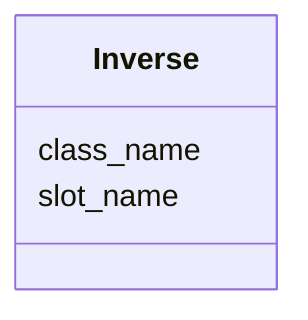

---
search:
  boost: 10.0
---

# Class: Inverse 


_Used for back references in mapping to relational model_


<div data-search-exclude markdown="1">


URI: [linkmlmap:class/Inverse](https://w3id.org/linkml/transformer/class/Inverse)





<!-- no inheritance hierarchy -->

## Slots

| Name | Cardinality and Range | Description | Inheritance |
| ---  | --- | --- | --- |
| [slot_name](../slots/slot_name.md) | 0..1 <br/> [String](../types/String.md) | Name of the slot on the referenced class that back-references the derived slo... | direct |
| [class_name](../slots/class_name.md) | 0..1 <br/> [String](../types/String.md) | Name of the class that holds the back-reference (foreign key) slot | direct |


## Usages

| used by | used in | type | used |
| ---  | --- | --- | --- |
| [SlotDerivation](../classes/SlotDerivation.md) | [inverse_of](../slots/inverse_of.md) | range | [Inverse](../classes/Inverse.md) |


## Aliases


* backref
* back_references


## Identifier and Mapping Information


### Schema Source


* from schema: https://w3id.org/linkml/transformer


## Mappings

| Mapping Type | Mapped Value |
| ---  | ---  |
| self | linkmlmap:Inverse |
| native | linkmlmap:Inverse |


## LinkML Source

<!-- TODO: investigate https://stackoverflow.com/questions/37606292/how-to-create-tabbed-code-blocks-in-mkdocs-or-sphinx -->

### Direct

<details>
```yaml
name: Inverse
description: Used for back references in mapping to relational model
from_schema: https://w3id.org/linkml/transformer
aliases:
- backref
- back_references
attributes:
  slot_name:
    name: slot_name
    description: Name of the slot on the referenced class that back-references the
      derived slot.
    from_schema: https://w3id.org/linkml/transformer
    rank: 1000
    domain_of:
    - Inverse
  class_name:
    name: class_name
    description: Name of the class that holds the back-reference (foreign key) slot.
    from_schema: https://w3id.org/linkml/transformer
    rank: 1000
    domain_of:
    - Inverse

```
</details>

### Induced

<details>
```yaml
name: Inverse
description: Used for back references in mapping to relational model
from_schema: https://w3id.org/linkml/transformer
aliases:
- backref
- back_references
attributes:
  slot_name:
    name: slot_name
    description: Name of the slot on the referenced class that back-references the
      derived slot.
    from_schema: https://w3id.org/linkml/transformer
    rank: 1000
    owner: Inverse
    domain_of:
    - Inverse
  class_name:
    name: class_name
    description: Name of the class that holds the back-reference (foreign key) slot.
    from_schema: https://w3id.org/linkml/transformer
    rank: 1000
    owner: Inverse
    domain_of:
    - Inverse

```
</details></div>